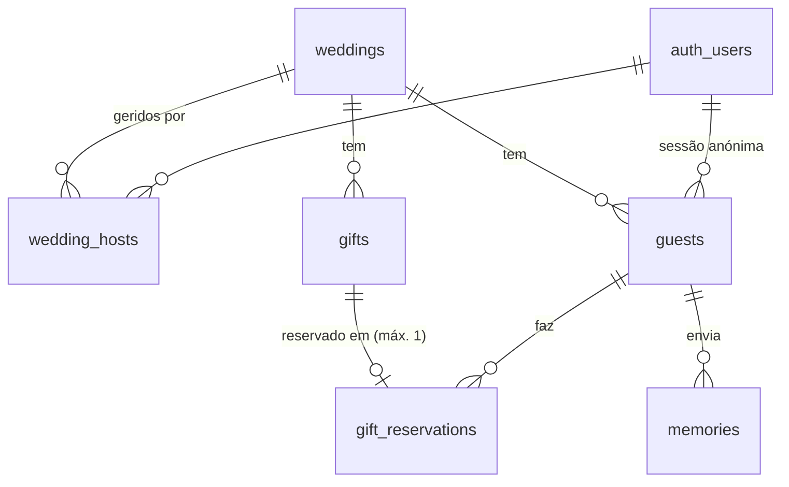

# Plano do projeto — Convite de Casamento

> Documento de trabalho: como vamos construir o convite, fase a fase.
> Termos do domínio em [`GLOSSARY.md`](../GLOSSARY.md). Decisões difíceis de reverter em [`docs/adr/`](./adr).

## 1. Âmbito

| Fase | O que é |
|---|---|
| **1 — agora** | O site de **um casamento**. Os noivos gerem tudo num painel privado. |
| **2 — depois** | **Plataforma** onde qualquer casal cria o seu convite com link próprio (`/maria-e-joao`). A base de dados já está preparada (ADR 0001). |

Funcionalidades da fase 1:

1. **Convite**: nomes dos noivos, data, hora e local, com **mapa** e botões para Google Maps, Waze e Apple Maps.
2. **Registo e resposta**: o convidado escreve o nome e diz se vai (confirmado ou recusado).
3. **Lista de presentes**: o convidado reserva um presente; **o mesmo presente não pode ser reservado duas vezes**.
4. **Memórias**: os convidados enviam fotos e vídeos; só os noivos veem a galeria e descarregam tudo (um a um ou num `.zip`).
5. **Painel dos noivos**: editar o casamento, gerir presentes, ver respostas e reservas, galeria e estatísticas.

## 2. Tecnologias

| Camada | Escolha | Porquê |
|---|---|---|
| Front-end + servidor | **Next.js 15** (App Router) + **TypeScript** | Páginas rápidas, Server Actions para o back-end, deploy nativo na Vercel |
| Estilos | **Tailwind CSS 4** | Design minimalista com tokens próprios, sem CSS solto |
| Base de dados | **Supabase (PostgreSQL)** com **RLS** | SQL a sério, segurança por linha, plano gratuito |
| Autenticação | Supabase Auth: **email** (noivos) e **sessão anónima** (convidados) | Convidados sem conta, mas protegidos (ADR 0003) |
| Ficheiros | **Supabase Storage**, bucket privado `memories` | URLs assinados; só os noivos veem tudo |
| Mapa | **Leaflet + OpenStreetMap**; geocodificação **Nominatim** | Grátis e sem chave de API (ADR 0004) |
| Validação | **Zod** | O mesmo esquema valida formulários e Server Actions |
| Download em massa | **client-zip** | Gera o `.zip` no browser dos noivos, sem custo de servidor |
| Testes | **Vitest** + **PGlite** (base de dados) + **agent-browser** (fluxos no browser) | Testar RLS sem Docker; testar o site como um convidado |
| Deploy | **Vercel** | Previews por cada push; produção no `main` |

## 3. Fluxos

### Convidado (telemóvel primeiro: o link chega por WhatsApp)

```
Abre o link ─► Vê o convite (nomes, data, local, mapa)
   └─► "Confirmar presença" ─► escreve o nome  [sessão anónima criada aqui]
          └─► Vai? Sim / Não  (+ mensagem opcional aos noivos)
                 └─► Lista de presentes ─► Reservar  (ou cancelar a sua reserva)
                        └─► No dia e depois: "Enviar memórias" ─► fotos/vídeos
```

Ao voltar ao site no mesmo telemóvel, o convidado é reconhecido e vê a sua resposta e as suas reservas.

### Noivos

```
/entrar (email + palavra-passe)
   └─► /painel
         ├─ Casamento: nomes, data, hora, local → guardar → coordenadas → mapa (pino ajustável)
         ├─ Presentes: criar, editar, ordenar, apagar; ver quem reservou
         ├─ Convidados: lista com resposta e mensagem; exportar CSV
         ├─ Galeria: ver memórias, descarregar uma ou todas (.zip)
         └─ Resumo: estatísticas (ver secção 6)
```

## 4. Rotas planeadas

| Rota | Quem | Conteúdo |
|---|---|---|
| `/` | Todos | Convite do casamento `NEXT_PUBLIC_WEDDING_SLUG` |
| `/presentes` | Convidados | Lista de presentes e reservas |
| `/memorias` | Convidados | Enviar fotos e vídeos; ver as suas |
| `/entrar` | Noivos | Login |
| `/painel`, `/painel/casamento`, `/painel/presentes`, `/painel/convidados`, `/painel/galeria` | Noivos | Gestão |

Na fase 2, o prefixo passa a ser `/[slug]/…` (ex.: `/maria-e-joao/presentes`).

## 5. Modelo de dados



Migrações em `supabase/migrations/`:

- `…_init.sql`: tabelas, restrições, triggers, RLS e a função `wedding_stats`.
- `…_storage_memories.sql`: bucket `memories` (privado, 50 MB, só imagem e vídeo) e políticas de acesso por pasta `{wedding_id}/{guest_id}/`.

Regras garantidas **pela base de dados** e cobertas por testes (`tests/db/schema.test.ts`, 18 testes):

- Um presente tem no máximo **uma reserva**, mesmo com dois cliques ao mesmo segundo (ADR 0002).
- O convidado só vê e altera os seus dados; não reserva nem envia ficheiros em nome de outro.
- A lista mostra se um presente está reservado **sem revelar quem** o reservou.
- Só os noivos editam o casamento e os presentes, e veem a galeria completa.
- Os dados de um casamento nunca aparecem a outro casal.
- Valores em **cêntimos** (`price_cents`), nunca números decimais.

## 6. Dados e estatísticas (painel dos noivos)

A função `wedding_stats(wedding_id)` devolve, numa só chamada:

| Indicador | Uso no painel |
|---|---|
| Convidados: total, confirmados, recusados, pendentes | Cartão de respostas e barra de progresso até ao prazo |
| Presentes: total, reservados, valor total e valor reservado (€) | Percentagem da lista já reservada |
| Memórias: total, fotos, vídeos, espaço ocupado | Aviso quando se aproxima de 1 GB (limite gratuito) |

Mais tarde: evolução das respostas por dia (para saber quem lembrar antes do prazo) e exportação CSV da lista de convidados para o catering.

## 7. Direção de design (proposta — a validar antes de codificar)

**Ideia:** o convite deve parecer **papelaria fina impressa**, não um site. Minimalismo com intenção: muito espaço em branco, tipografia como protagonista, uma única cor de destaque.

- **Abertura (hero):** os nomes dos noivos em tipografia grande com serifa, como impressos em relevo; a data numa linha discreta por baixo (`12 · 06 · 2027`), sem estatísticas nem ícones.
- **Paleta:** papel `#F6F2EA`, tinta `#24231F`, uma cor de destaque (verde-sálvia `#6E7B5C`), linhas finas `#D9D2C3`. Modo escuro como "papel à noite".
- **Tipografia:** uma serifa com carácter para os nomes e títulos (ex.: *Cormorant Garamond*) + uma sem-serifa muito legível para formulários e botões (ex.: *Instrument Sans*).
- **Intuitivo:** um passo de cada vez (nome → resposta → presentes); botões grandes para o polegar; estados claros ("Reservado por ti", "Já reservado", "Disponível").
- **Movimento:** discreto — o presente "vira" quando é reservado; nada de animações que atrasem.
- **Acessibilidade:** contraste AA, navegação por teclado, textos alternativos, formatos portugueses (`12 de junho de 2027`, `16h00`, `120,00 €`).

Skills a usar: **frontend-design** (direção e identidade) e **ui-ux-pro-max** (verificação de UX, acessibilidade e combinações de fontes).

## 8. Limites e riscos

| Risco | Mitigação |
|---|---|
| Vídeos grandes (limite gratuito: **50 MB por ficheiro**, **1 GB total**) | Avisar antes de enviar; comprimir no browser; plano Pro do Supabase se necessário |
| Alguém com o link reserva todos os presentes | Limite de reservas por convidado (a decidir) + CAPTCHA Cloudflare Turnstile no registo anónimo |
| Nominatim: 1 pedido/segundo, exige identificação | Só os noivos geocodificam, uma vez por morada; pino ajustável à mão |
| Convidado muda de telemóvel e "perde" a sessão | Aceite na fase 1 (ADR 0003); os noivos podem fundir registos duplicados no painel |
| Datas e fusos horários | `starts_at` em `timestamptz` + `time_zone = 'Europe/Lisbon'` |

## 9. Fases de desenvolvimento

| # | Entrega | Skills |
|---|---|---|
| 0 | ✅ **Ambiente**: projeto, esquema, RLS, testes, glossário, ADRs, este plano | domain-modeling, supabase-postgres-best-practices, tdd |
| 1 | Design: tokens, tipografia, componentes base, protótipo da página do convite | frontend-design, ui-ux-pro-max |
| 2 | Convite público + mapa | tdd, frontend-design |
| 3 | Registo do convidado + resposta | tdd, supabase-postgres-best-practices |
| 4 | Lista de presentes + reservas (tempo real) | tdd |
| 5 | Login dos noivos + painel (casamento, presentes, convidados) | tdd, security-review |
| 6 | Memórias: envio + galeria + download .zip | tdd, agent-browser |
| 7 | Estatísticas | dataviz |
| 8 | Revisão final e deploy na Vercel | code-review, security-review, agent-browser |

## 10. Perguntas em aberto

Cenários a decidir com os noivos antes das fases 3–6:

1. **Um convidado que recusa** o convite pode reservar um presente ou enviar memórias? *(Agora: sim.)*
2. **Acompanhantes:** a resposta inclui "quantas pessoas vêm" (ex.: casal com dois filhos)?
3. **Presentes em dinheiro** (ex.: "Voo da lua de mel"): só um convidado pode oferecer, ou vários contribuem com partes? A regra "não pode ser escolhido duas vezes" vale para todos?
4. **Limite de reservas** por convidado (ex.: no máximo 3)?
5. **Memórias:** os convidados veem as dos outros, ou só os noivos? *(Agora: só os noivos.)* O envio abre só no dia do casamento?
6. **Prazo de resposta:** depois da data, o convidado ainda pode responder ou mudar de ideia?

## 11. Pôr o ambiente a funcionar

1. Criar um projeto em [supabase.com](https://supabase.com) (região: Europa).
2. Em **Authentication → Sign In / Providers**, ativar **Anonymous sign-ins** e **Email**.
3. Ligar e aplicar as migrações:
   ```bash
   npx supabase login
   npx supabase link --project-ref <ref-do-projeto>
   npx supabase db push
   ```
4. Copiar `.env.example` para `.env.local` e preencher.
5. Criar o casamento: no **SQL Editor**, correr o conteúdo de `supabase/seed.sql` com os dados reais (nomes, data, local, presentes). Localmente, `npx supabase db reset` já o carrega.
6. Criar a conta dos noivos (Authentication → Users) e ligá-la ao casamento no SQL Editor:
   ```sql
   insert into wedding_hosts (wedding_id, user_id)
   select w.id, u.id from weddings w, auth.users u
   where w.slug = 'maria-e-joao' and u.email = 'noivos@exemplo.pt';
   ```
7. `npm run dev` e abrir http://localhost:3000.
8. Na Vercel: importar o repositório do GitHub e adicionar as mesmas variáveis de ambiente.
